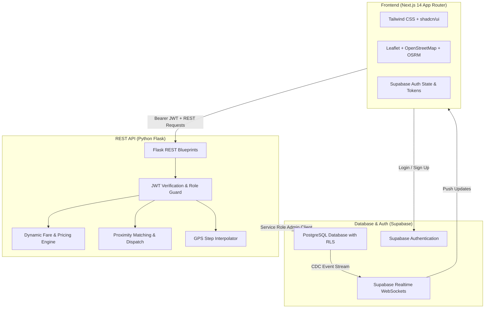

<div align="center">

# 🚗 Kuber – Modern Ride Booking Platform

[](https://nextjs.org/)
[](https://www.typescriptlang.org/)
[](https://python.org/)
[](https://flask.palletsprojects.com/)
[](https://supabase.com/)
[](https://tailwindcss.com/)
[](LICENSE)

**A high-performance, full-stack Uber-like ride booking web application built with Next.js 14, Python Flask REST API, Supabase PostgreSQL with Row Level Security, and interactive OpenStreetMap navigation.**

[Features](#-key-features) • [Architecture](#-system-architecture) • [Getting Started](#-getting-started) • [API Documentation](#-api-documentation) • [Demo Walkthrough](#-testing-the-ride-lifecycle)

</div>

---

## 🌟 Key Features

### 👤 Passenger Portal
- **Interactive Booking Map:** Free OpenStreetMap + Leaflet map with CartoDB Voyager tiles, interactive pins, and live road routing via OSRM.
- **Dynamic Tiered Pricing:** Real-time distance and time estimation with multi-tier fare breakdown:
  - **Kuber Go (Standard):** Economical daily travel (4 passenger capacity).
  - **Kuber Comfort:** Top-rated drivers and newer vehicles (4 passenger capacity).
  - **Kuber XL:** Spacious SUVs for groups and luggage (6 passenger capacity).
- **Live GPS Tracking:** Smooth real-time driver car icon movement with compass heading angle rotation.
- **Lifecycle Control:** Instant booking requests, cancellation with reason tracking, and completed trip receipts.
- **Trip History:** Past rides list with date, vehicle category, fare amount, and driver records.

### 🚘 Driver Portal
- **Online / Offline Toggle:** Switch working status instantly with a single toggle.
- **Live Dispatch Feed:** Broadcasts incoming passenger requests in `pending` status with addresses, distance, and fare.
- **Atomic Concurrency Protection:** Race-condition-safe ride acceptance ensures two drivers cannot accept the same trip.
- **In-Trip State Machine Controller:**
  $$\text{accepted} \longrightarrow \text{driver\_arriving} \longrightarrow \text{in\_progress} \longrightarrow \text{completed}$$
- **Vehicle Profile Management:** Register vehicle make, model, color, year, license plate, and category.
- **Earnings Ledger:** Real-time summary of gross earnings, completed trip count, and driver ratings.

### 🧪 Built-in Simulation Engine
- **Zero-Device Testing:** Built-in GPS route interpolation moves the driver car along the road in real-time, allowing 100% end-to-end evaluation without needing a second physical device.

---

## 🏗️ System Architecture



---

## 📂 Project Structure

```text
kuber/
├── frontend/                     # Next.js 14 App Router (TypeScript)
│   ├── src/
│   │   ├── app/                  # App routes
│   │   │   ├── (auth)/login/     # Login page with 1-click demo accounts
│   │   │   ├── (auth)/register/  # Passenger & Driver registration
│   │   │   ├── (passenger)/      # Book, Track, Dashboard, History
│   │   │   ├── (driver)/         # Dashboard, Requests, Active Trip, Vehicle, Earnings
│   │   │   ├── layout.tsx        # Global layout & toast providers
│   │   │   └── page.tsx          # Modern landing page
│   │   ├── components/           # Reusable UI & Map components
│   │   ├── context/              # AuthContext & Session management
│   │   ├── lib/                  # API client, Supabase client, utils
│   │   └── types/                # TypeScript domain models
│   ├── .env.example              # Public frontend environment template
│   └── package.json
│
├── backend/                      # Python Flask REST API
│   ├── app/
│   │   ├── middleware/           # auth.py (JWT verify & RBAC), error_handler.py
│   │   ├── routes/               # Modular Flask Blueprints
│   │   ├── services/             # Fare, matching, simulation services
│   │   ├── utils/                # Haversine distance, bearings, geo math
│   │   ├── config.py             # Environment configuration
│   │   └── extensions.py         # Supabase client initialization
│   ├── scripts/                  # Seed scripts & automated user creation
│   ├── tests/                    # Pytest test suite (100% passing)
│   ├── run.py                    # Server entrypoint
│   ├── requirements.txt
│   └── .env.example              # Privileged backend environment template
│
├── supabase/
│   ├── schema.sql                # Complete PostgreSQL schema (tables, RLS, triggers)
│   └── seed.sql                  # Seed coordinates & sample references
│
├── .github/workflows/ci.yml      # Automated GitHub Actions CI workflow
├── start-all.bat                 # 1-Click Windows batch launcher
├── CONTRIBUTING.md
├── CODE_OF_CONDUCT.md
├── LICENSE
└── README.md
```

---

## ⚡ Getting Started

### 1. Prerequisites
- [Node.js](https://nodejs.org/) v18 or newer
- [Python](https://python.org/) v3.10 or newer (v3.12 recommended)
- [Supabase](https://supabase.com/) Account (Free tier)

---

### 2. Database Provisioning (Supabase)
1. Go to your [Supabase Dashboard](https://supabase.com).
2. Open **SQL Editor** $\rightarrow$ **New query**.
3. Copy and paste the contents of [`supabase/schema.sql`](supabase/schema.sql) and click **Run**.
4. In **Authentication** $\rightarrow$ **Providers** $\rightarrow$ **Email**, toggle **OFF** "Confirm email" to enable instant test logins.

---

### 3. Environment Variables

#### Frontend Setup (`frontend/.env.local`):
```bash
NEXT_PUBLIC_SUPABASE_URL=https://your-project.supabase.co
NEXT_PUBLIC_SUPABASE_ANON_KEY=your-anon-publishable-key
NEXT_PUBLIC_API_BASE_URL=http://localhost:5000
NEXT_PUBLIC_MAP_PROVIDER=osm
```

#### Backend Setup (`backend/.env`):
```bash
FLASK_ENV=development
FLASK_PORT=5000
SECRET_KEY=your-random-32-char-secret-key
CORS_ORIGINS=http://localhost:3000

SUPABASE_URL=https://your-project.supabase.co
SUPABASE_SERVICE_ROLE_KEY=your-supabase-service-role-key
SUPABASE_JWT_SECRET=your-supabase-jwt-secret

ENABLE_DEMO_SIMULATION=true
BASE_FARE=50.0
PER_KM_RATE=12.0
PER_MINUTE_RATE=2.0
```

---

### 4. Running the Servers

#### Method A: 1-Click Windows Launcher
Double click [`start-all.bat`](start-all.bat). It opens two windows running both servers automatically!

#### Method B: Running Separately
```bash
# Terminal 1 - Start Flask API
cd backend
python -m pip install -r requirements.txt
python run.py
# Backend runs on http://localhost:5000

# Terminal 2 - Start Next.js Frontend
cd frontend
npm install
npm run dev
# Frontend runs on http://localhost:3000
```

---

## 🔌 API Documentation

| Method | Endpoint | Authorization | Description |
|---|---|---|---|
| `GET` | `/api/health` | Public | Health check and server status |
| `POST` | `/api/auth/sync` | Bearer Token | Syncs user profile metadata with PostgreSQL |
| `GET` | `/api/auth/me` | Bearer Token | Returns authenticated user profile and active trip |
| `POST` | `/api/passenger/rides/estimate` | Bearer Token | Computes multi-tier fares (`standard`, `comfort`, `xl`) |
| `POST` | `/api/passenger/rides/request` | Passenger Role | Requests a new ride in `pending` status |
| `GET` | `/api/passenger/rides/active` | Passenger Role | Fetches passenger's current active ride and driver |
| `POST` | `/api/passenger/rides/<id>/cancel` | Passenger Role | Cancels a ride if allowed by status rules |
| `GET` | `/api/passenger/rides/history` | Passenger Role | Retrieves passenger's completed/cancelled trip history |
| `POST` | `/api/driver/status` | Driver Role | Toggles driver `is_online` and `is_available` |
| `POST` | `/api/driver/location` | Driver Role | Updates coordinates and logs trip breadcrumb |
| `GET` | `/api/driver/rides/available` | Driver Role | Fetches real-time pending rides in the city |
| `POST` | `/api/driver/rides/<id>/accept` | Driver Role | Atomically accepts a ride request |
| `POST` | `/api/driver/vehicle` | Driver Role | Registers or updates vehicle details |
| `GET` | `/api/driver/dashboard` | Driver Role | Driver metrics: gross revenue, total trips, active trip |
| `POST` | `/api/rides/<id>/status` | Driver Role | Enforces state machine transitions (`driver_arriving`, `in_progress`, `completed`) |
| `POST` | `/api/rides/<id>/simulate-step` | Bearer Token | Advances simulated driver coordinates on route |
| `GET` | `/api/location/search?q=...` | Public | Autocomplete address search with landmark fallbacks |
| `POST` | `/api/location/route` | Public | Computes road polyline waypoints via OSRM |

---

## 🧪 Testing the Ride Lifecycle

### One-Click Simulation Test (Single User)
1. Open [`http://localhost:3000/login`](http://localhost:3000/login).
2. Click **"Demo Passenger"** $\rightarrow$ **Sign In**.
3. Go to **Book a Ride** (`/passenger/book`).
4. Select a destination (e.g., *Koramangala Sony World Signal*).
5. Choose a vehicle tier (**Kuber Go**, **Comfort**, or **XL**).
6. Leave **"Auto-match Demo Driver"** checked and click **Request Ride**.
7. In the **Live Tracker** (`/passenger/track/<id>`), click **"Advance Driver Location on Map"** to watch the driver navigate in real-time!

---

### Two-Sided Test (Passenger + Driver)
1. **Window 1 (Passenger):** Open an incognito browser window at `http://localhost:3000/login` and log in as Passenger.
2. **Window 2 (Driver):** In your normal window, log in as Driver (`driver.test@kuber.local` / `Password123!`).
3. In Window 2 (Driver):
   - Toggle **Go Online**.
   - Go to **Available Trips** (`/driver/requests`).
4. In Window 1 (Passenger):
   - Uncheck "Auto-match Demo Driver" and click **Request Ride**.
5. In Window 2 (Driver):
   - The ride appears instantly in the live feed. Click **Accept Trip**.
   - Click **"Mark Arrived at Pickup"** $\rightarrow$ **"Start Trip"** $\rightarrow$ **"Complete Trip"**.
6. Both screens update in real-time with receipts generated and recorded into trip histories!

---

## 🔒 Security Best Practices

- **Zero Secrets Committed:** Production credentials reside exclusively in uncommitted `.env` files.
- **Service-Role Isolation:** The Supabase `service_role` secret key is never exposed to the frontend client.
- **Server-Side Pricing:** All fare calculations, distances, and status changes are computed and verified by the Flask backend.

---

## 📄 License

This project is licensed under the [MIT License](LICENSE).
